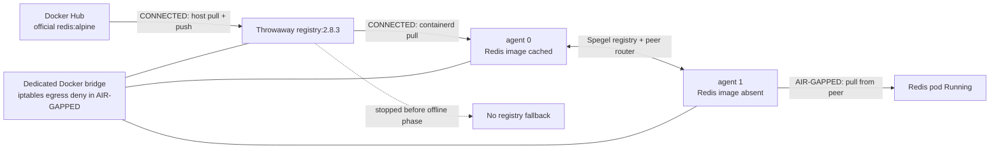

# Spegel: peer-to-peer image distribution in k3d

| Spectrum level | Demo app | Headline tooling | Status |
|----------------|----------|------------------|--------|
| 3 | redis | spegel, k3d, zot | 🚧 WIP |

Nodes fetch images from each other with the central registry down

[Offline spectrum](../../docs/offline-spectrum.md) · [Top-level README](../../README.md)

Spegel makes each Kubernetes node a stateless local OCI registry mirror. This
demo begins with a single copy of the official Redis Alpine image on agent 0,
then stops the registry and schedules three `Always`-pull replicas across both
agents. Agent 1 must obtain the image through Spegel peers; it cannot fall back
to Docker Hub or any other internet registry.

## Offline spectrum

**Offline spectrum: level 3.** See the shared [offline spectrum](../../docs/offline-spectrum.md).
This demo proves cluster-internal image distribution, not provisioning a new
cluster or its tools in an air gap.

Without Spegel, agent 1 has no image and cannot reach the stopped registry.
Its pull fails and the pod enters `ImagePullBackOff`.

## Architecture



The one-server/two-agent k3d cluster and the throwaway registry use a dedicated
Docker bridge. The image and Spegel application image are pulled by the
connected host, while the connected registry is reachable from the nodes. At
the phase boundary the registry is stopped and iptables `OUTPUT` and `FORWARD`
rules on each k3d node reject traffic outside the Docker-node, k3s-pod and
k3s-service CIDRs. The host remains the connected orchestration boundary and
is not a physically disconnected machine.

## Prerequisites

- Linux amd64, Docker Engine with permission to create privileged k3d nodes,
  and at least 4 CPUs, 6 GiB available RAM and 4 GiB free disk.
- Bash 4+, `curl`, `helm` **v4.3.0**, `sha256sum`, `awk`, `grep`, `sed`,
  `timeout`, and standard GNU userland tools.
- Docker Hub and GHCR access during CONNECTED setup. Docker Hub anonymous
  pull-rate limits may affect the host image pull.
- Host port `127.0.0.1:5000` free. The script downloads the pinned k3d v5.9.0
  Linux amd64 binary and verifies its SHA-256 before executing it.
- No existing k3d cluster, Docker network, or container using the fixed
  `spegel-p2p` demo names.

The script preloads the pinned k3s node image and Spegel image, and downloads
the matching Helm chart before cluster deployment. No pod image is allowed to
depend on internet access. Tool binaries and pulled images remain in the
Docker image cache / `.tools` after cleanup; the cluster, registry, Docker
network and downloaded chart are removed.

## Run the demo

From this directory, run the complete presentation in one terminal:

```bash
./scripts/run-demo.sh
```

At the phase boundary, press Enter after narrating the connected evidence. For
an unattended rehearsal:

```bash
DEMO_AUTO_ADVANCE=1 ./scripts/run-demo.sh
```

The script prints a phase banner, clears the terminal between phases when it
is interactive, and pauses briefly after banners. It cleans up on success,
failure, Ctrl-C or termination. The Redis Deployment is constrained to the two
agent nodes and topology-spread so three replicas necessarily place at least
one pod on each agent.

The optional registry rollback and second-pull check can be enabled without
changing the default run:

```bash
DEMO_ROLLBACK=1 DEMO_AUTO_ADVANCE=1 ./scripts/run-demo.sh
```

This enables manifest deletion only on the throwaway local registry created
for this demo. It does not delete or modify Docker Hub content.

### CONNECTED phase

1. The host pulls `docker.io/library/redis:alpine`, tags it as
   `localhost:5000/library/redis:alpine`, and pushes it into a separate
   `registry:2.8.3` container.
2. k3d creates one server and two agents on a dedicated Docker bridge. K3s
   mounts the containerd v3 config patch from
   [`config/containerd-v3.d/10-spegel.toml`](config/containerd-v3.d/10-spegel.toml):
   `snapshotter = "overlayfs"`,
   `discard_unpacked_layers = false`, and isolated content sharing. K3s maps
   the demo registry hostname `registry:5000` to the local HTTP registry; the
   platform's unrelated `docker.io` image pulls retain their normal behavior.
   Kubelet uses explicit 1 GiB disk eviction thresholds and 99/98% image-GC
   thresholds so modest free space in a Docker-backed sandbox does not taint
   every node before the workload starts; the script fails if any node still
   reports `DiskPressure`.
3. The chart and Spegel v0.8.0 image are loaded, then Spegel is installed with
   k3s-specific socket, content-store and certs.d paths.
4. Only agent 0 pulls the Redis image into its `k8s.io` containerd namespace.
   The script asserts that the image is absent on agent 1 before the outage.

Expected evidence includes:

```text
CONNECTED EVIDENCE: pre-pull Redis only on node A (k3d-spegel-p2p-agent-0).
...
Node A image record:
registry:5000/library/redis:alpine ...
Node B image record: absent, as required.
Containerd patch: discard_unpacked_layers=false; snapshotter=overlayfs on all three nodes.
```

### AIR-GAPPED phase

The registry container is stopped. Before deploying, the script installs
iptables `OUTPUT` and `FORWARD` egress blocks on all three nodes, then makes a
direct external HTTP probe from each node and checks that the reject counter
increases. It also probes from the Redis pod on agent 1 and checks the
forwarding reject counter. The workload uses `imagePullPolicy: Always`, so a
cached tag on agent 0 cannot mask an unsuccessful pull on agent 1.

The script then waits for three Running pods, checks that one is on
`k3d-spegel-p2p-agent-1`, confirms Redis arrived in that node's containerd
image list, prints Spegel's agent-0 logs, and checks the requesting agent's
Prometheus mirror-hit metric.

Expected final evidence:

```text
CENTRAL REGISTRY: stopped
EXTERNAL EGRESS BLOCKED: k3d-spegel-p2p-agent-0 (reject counter 0 -> 2)
EXTERNAL EGRESS BLOCKED: k3d-spegel-p2p-agent-1 (reject counter 0 -> 2)
...
POD EGRESS BLOCKED: node B FORWARD reject counter 0 -> 2
redis-peer-demo-...  k3d-spegel-p2p-agent-1  Running
...
spegel_mirror_requests_total{cache="hit",registry="registry:5000"} 11
PASS: node B started Redis with the central registry stopped and external egress blocked.
```

Exact digests, pod names, log fields and metric counters vary between runs.
The validated run showed HTTP `GET` requests for the Redis manifest and layer
blobs in agent 0's Spegel logs, with the requesting pod IP on agent 1's peer
traffic. The requester recorded a `cache="hit"` metric.
`TOTAL RUNTIME` is printed after cleanup. Run `./scripts/cleanup.sh` separately
if setup was interrupted before the orchestrator installed its exit trap.

### Optional rollback exercise

With `DEMO_ROLLBACK=1`, the connected phase deletes the Redis manifest from
the disposable registry after agent 0 has pulled it, then verifies the
`alpine` tag returns HTTP 404. The ordinary air-gapped deployment therefore
already proves a fresh agent-1 pull succeeds with no registry copy. After that
baseline evidence, the script synchronously removes agent 1's Redis image
reference and deletes one of its running Redis pods. The Deployment controller
recreates it; the check requires the replacement to run, Redis to return to
agent 1's containerd image list, the agent-1 peer-hit metric to increase, and
agent 0's Spegel logs to show Redis manifest/blob requests for the retry.

Expected additional evidence:

```text
ROLLBACK SETUP: deleted registry manifest sha256:...; alpine now returns HTTP 404.
ROLLBACK PASS: redis-peer-demo-... replaced redis-peer-demo-... on node B; peer hits 10 -> 11.
```

The image is removed only from the disposable demo registry and agent 1; agent
0 remains the peer source throughout. The default run does not enable registry
deletion or perform the extra pull.

### Metrics snapshot

The default run prints the requester metrics directly from Spegel's
Prometheus endpoint, along with the source peer's request logs. In this setup
that live scrape is the most direct evidence and avoids adding Grafana,
Prometheus, extra images, and their own air-gap and lifecycle requirements.
No dashboard screenshot is bundled. For a presentation, the printed
`spegel_mirror_requests_total{cache="hit",registry="registry:5000"}` counter
is the key metric; with rollback enabled, compare its before/after values to
show the retry was served again.

## Troubleshooting

- **Port 5000 is occupied:** stop the process using `127.0.0.1:5000`, then
  retry. Cleanup does not remove unrelated containers or networks.
- **Docker Hub denies the Redis pull:** authenticate Docker on the host or retry
  after the anonymous pull limit resets. The demo does not silently substitute
  another Redis image or tag.
- **k3d binary checksum mismatch:** the script aborts before execution. Confirm
  the pinned v5.9.0 release artifact has not changed; do not bypass the check.
- **Spegel pods are not Ready:** inspect the preceding Helm / pod events output.
  The most common k3s-specific error is a wrong containerd socket or host
  content-store path. Compare the values in `config/spegel-values.yaml` with
  the paths inside the pinned k3s nodes.
- **Containerd patch assertion fails:** inspect
  `/var/lib/rancher/k3s/agent/etc/containerd/config.toml` inside each node.
  k3s 1.35 uses the v3 config import directory mounted by k3d; don't replace
  the generated `config.toml` with an incomplete hand-written file.
- **Agent 1 cannot pull after registry shutdown:** confirm Spegel is Ready on
  all nodes, the tag is present on agent 0, and the agent-to-agent network is
  healthy. `config/spegel-values.yaml` configures the `http://registry:5000`
  mirror explicitly. The script deliberately fails rather than reporting a
  fallback as peer success.
- **Registry inaccessible from the host:** ensure loopback port 5000 is not
  occupied and Docker has created the published loopback mapping.
- **Interrupted run left resources:** run `./scripts/cleanup.sh`, then rerun.
  Cleanup checks demo ownership labels before deleting cluster, registry or
  network resources.

## Cleanup

The orchestrator automatically removes the cluster, registry, Docker network
and temporary Helm archive, including on failure. To clean up explicitly:

```bash
./scripts/cleanup.sh
```

The local k3d binary and Docker images are intentionally retained for faster
rehearsals. Remove `./.tools/` or prune Docker images manually only when you
want to reclaim their cached disk space.

## Future tooling

Spegel's stateless, node-local OCI mirror is an emerging alternative to
deployments that rely on a central pull-through cache for every node. The next
steps for production use are stronger operational validation: supported
containerd-version matrices, peer health and capacity telemetry, explicit
image-retention policies, and a clear policy for peer discovery across network
boundaries. This is a demonstration of the current project, not a claim of
enterprise support guarantees.

## Where network is still required

- CONNECTED setup requires the host to reach Docker Hub for the Redis image,
  GHCR for Spegel and its Helm chart, and Docker Hub for the k3s/registry
  images. The host pushes Redis into the local registry.
- In AIR-GAPPED, host and pod egress from the k3d nodes is rejected by
  per-node iptables rules, with node and pod probes confirmed by increasing
  REJECT counters. Peer traffic within the Docker-node and Kubernetes
  pod/service CIDRs remains allowed. Stopping the throwaway registry proves it
  is not the scale-out dependency.
- Docker itself, the host OS, and the Docker control socket remain outside the
  simulated air gap. The Docker host is not firewalled, the registry isn't a
  hardware-isolated appliance, and internal networking is not a security
  boundary against a privileged host operator. Production deployments still
  need a separate plan to stage Kubernetes, Spegel, charts, images, and trust
  material into the cluster.

## Known limitations

- `redis:alpine` is the user-requested mutable tag. Its content changes over
  time; the connected host's resolved digest is what this individual run
  transfers.
- k3d and Docker approximate node networking and do not model a physical
  disconnected network, hostile multi-tenancy, or real-world failure domains.
  The iptables policy is applied inside privileged node containers and can be
  bypassed by the Docker host or a privileged operator.
- Three replicas across two agent nodes prove scale-out to a peer; they do not
  test an entire cluster bootstrap without a registry.
- Metrics and logs are captured from the demo's short-lived pods, not persisted
  in a production monitoring stack.

## Tested with

Test date: **2026-10-16**.

- Docker Engine **29.9.1** (Linux amd64)
- Helm **v4.3.0+gbec5b06**
- k3d **v5.9.0** (downloaded by the script and SHA-256 verified)
- K3s node image **rancher/k3s:v1.35.5-k3s1**
- Spegel chart and image **v0.8.0**
- Registry image **registry:2.8.3**
- Redis **docker.io/library/redis:alpine**, resolved during the test to
  `sha256:3811787313eba226a2ef38658c6ccb91cd5e110edc89c37767de373120a0e5a0`

Validated end-to-end in **62 seconds** for the default run and **61 seconds**
with the optional rollback exercise, including cleanup. All three pods
reached `Running`; agent 1's containerd gained Redis with the registry stopped,
all node and pod egress probes were blocked, and Spegel reported peer mirror
hits. The rollback run deleted the registry tag (verified HTTP 404), recreated
a pod on agent 1, and increased its peer-hit count from 10 to 11.
